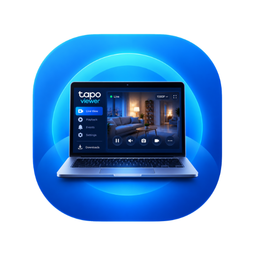

<div align="center">



# Tapo-Viewer

**Ability to play live and download recorded clips with modern GUI from Tapo devices**

[](https://github.com/zaifears/tapo-viewer/releases)
[](https://github.com/zaifears/tapo-viewer)
[](https://www.python.org/)
[](https://github.com/JurajNyiri/pytapo)
[](https://github.com/TomSchimansky/CustomTkinter)
[](LICENSE)
[](https://github.com/zaifears/tapo-viewer)

<br/>

<p align="center">
  <a href="https://github.com/zaifears/tapo-viewer/releases/latest"><b>📥 Download Standalone (.exe)</b></a> •
  <a href="#-app-previews"><b>📸 Previews</b></a> •
  <a href="#-features"><b>✨ Features</b></a> •
  <a href="#actual-readme"><b>🔑 Actual Readme</b></a> •
  <a href="#-quick-start-running-from-source"><b>🚀 Quick Start</b></a> •
  <a href="#-special-thanks-to-pytapo"><b>❤️ PyTapo</b></a> •
  <a href="#-supported-cameras"><b>📹 Supported Devices</b></a>
</p>

</div>

---

### 📥 Standalone Windows Release

The standalone Windows build includes:

- The Python runtime
- The application dependencies
- FFmpeg and FFprobe
- The LibVLC playback runtime
- Required UI assets

Users of the standalone release do not need to install Python, FFmpeg,
VLC, or another media player separately.

External VLC, mpv.net, PotPlayer, or FFplay installations remain
supported as optional playback fallbacks.

1. Head over to **[Releases](https://github.com/zaifears/tapo-viewer/releases/latest)**.
2. Download **`Tapo-Viewer.exe`** (or the `.zip` archive).
3. Double-click to run. All dependencies and UI assets are baked into the executable.

---

## 📸 App Previews

### 🎛️ Live Dashboard & MicroSD Manager
> Browse camera recordings with the interactive calendar, view motion events on the scrollable timeline, launch live 1080p RTSP feeds in your favorite video player, and monitor download progress with the docked manager.

<p align="center">
  
</p>

<br/>

### 🔐 Streamlined Onboarding & Dual-Connection Setup
> Fits standard laptop displays (1366×768) and high-DPI monitors with zero vertical scrolling. Connect with your camera credentials, choose whether you need cloud password authentication for MicroSD downloads, and select your preferred media player.

<p align="center">
  
</p>

---

## 💡 What is Tapo-Viewer?

Official Tapo desktop software does not exist, and viewing SD card recordings usually forces you to use the mobile app or pay for Tapo Care cloud storage.

**Tapo-Viewer** gives you a clean desktop app on Windows to:
- **Watch live camera feeds** directly inside your favorite desktop player (VLC, mpv.net, PotPlayer, or FFplay) with zero latency.
- **Browse SD card recordings** through an interactive calendar with dots marking days that contain recordings.
- **Download motion events and continuous recordings** directly to your computer as ready-to-watch `.mp4` video files.
- **Keep everything 100% private and local.** The app communicates directly with your camera over your home Wi-Fi/LAN. Nothing is sent to third-party servers.

---

<a id="actual-readme"></a>
## 🔑 Actual Readme
> **The Two Tapo Accounts — read this before connecting!**

Tapo cameras use **two completely separate logins**. Tapo-Viewer needs both, because live video and SD-card recordings are accessed in two different ways.

| | **1. Camera Account** | **2. Tapo / TP-Link Cloud Account** |
|---|---|---|
| **What it is** | A local username + password you create *inside the camera's settings* | The email + password you use to sign in to the Tapo app (your TP-Link ID) |
| **Created in** | Tapo app ➔ Camera ➔ ⚙️ ➔ Advanced Settings ➔ Camera Account | When you first registered in the Tapo app |
| **Official purpose** | Third-party access: RTSP/ONVIF software, NAS, PC viewers | Your normal Tapo app login |
| **Used by Tapo-Viewer for** | 🎥 **Live view** (RTSP stream on port 554) | 💾 **SD-card recordings** (calendar, listing & downloading, camera control port 443) |
| **Where you type it here** | **Camera Account Username / Password** fields | **"Different Cloud Password"** option |

> ⚠️ The Camera Account is **not** your TP-Link email login. TP-Link states it is intentionally kept separate so your main TP-Link ID credentials are never handed to third-party software, and recommends using a different, strong password for it.

<a id="create-camera-account"></a>
### Step 1 — Create the Camera Account (once per camera)

Following [TP-Link's official guide](https://www.tp-link.com/us/support/faq/2790/):

1. Open the **Tapo app** and tap your camera to open **Live View**.
2. Tap the **gear icon** (top-right) to open **Device Settings**.
3. Tap **Advanced Settings** ➔ **Camera Account**.
4. Create a **username and password**. (If one exists already, enter the current password first, then set the new details.)
5. Save it. Write the username and password down — you'll enter them in Tapo-Viewer.

> 💡 Tip: If login fails later, reset the Camera Account and avoid special characters in the password. TP-Link's own troubleshooting suggests this for RTSP login problems.

### Step 2 — Find your camera's IP address

In the Tapo app: Camera ➔ ⚙️ ➔ **Device Info** ➔ **IP Address** (for example `192.168.0.103`). Giving the camera a fixed ("reserved") IP in your router stops it from changing.

<a id="connect-in-tapo-viewer"></a>
### Step 3 — Connect in Tapo-Viewer

1. **Camera IP Address:** the address from Step 2 (no `http://` or port).
2. **Camera Account Username / Password:** the account from Step 1.
3. **Cloud password for SD-card access:**
   - Tick **"Different Cloud Password"** and enter the password you use to sign in to the Tapo app (your TP-Link account password). **This is what most users need**, because it usually differs from the Camera Account password.
   - Leave it unticked **only** if your Tapo/TP-Link password and Camera Account password happen to be identical.
4. Click **Connect Camera**.

**What happens behind the scenes:**

```
Step A  Camera Account  ──►  RTSP port 554   ──►  Live video          (proves camera account is correct)
Step B  Cloud password  ──►  Control port 443 ──►  SD card calendar & clip downloads
```

Tapo-Viewer talks only to your camera over your local network. Your passwords are never sent to any server, and are saved only if you tick **"Remember credentials on this PC"** (stored in Windows Credential Manager).

<a id="error-codes"></a>
### Which error means what?

| Error code | Meaning | Fix |
|---|---|---|
| `ERR_RTSP_AUTH` – *Camera Account Rejected* | Step A failed | Re-check the Camera Account username/password from Step 1 (case-sensitive; not your email login) |
| `ERR_RTSP_REFUSED` / `ERR_CAMERA_TIMEOUT` | Camera not reachable | Check IP address, same network, camera online |
| `ERR_CLOUD_AUTH` – *SD Card Login Rejected* | Step A worked, Step B failed | Tick **Different Cloud Password** and enter your Tapo app password |
| `ERR_CAMERA_LOCKED` | Too many wrong attempts | Wait a few minutes, then retry with the correct password |

Every error now shows its likely causes and numbered fix steps inside the app.

### Good to know (from TP-Link's documentation)

- **Camera Account only matters for third-party software.** If you only ever use the Tapo app, you never need it — but Tapo-Viewer does.
- **Ports:** RTSP is on port **554** (`/stream1` = high quality, `/stream2` = standard quality); ONVIF uses port 2020.
- **Battery-powered cameras** generally do not support RTSP/ONVIF, so they won't work with live view in this app. Some doorbells work only when hard-wired and in always-on mode. Check [TP-Link's list](https://www.tp-link.com/us/support/faq/4465/) for your model.
- **Limited streams:** Tapo Care (cloud), SD-card recording and NVR/NAS/ONVIF software can't all run at once — only two of the three. Close other viewers if the camera reports it is busy.
- **Dual-lens cameras:** only the wide-angle lens is available through RTSP/ONVIF.
- **Firmware:** Some firmware updates change third-party login behavior. If connecting suddenly stops working after an update, re-create the Camera Account and re-enter your cloud password.
- **Keep it local:** Do not port-forward the camera to the internet. TP-Link recommends a VPN instead, as RTSP is not designed for open internet exposure.

Sources: [TP-Link: Tapo Camera Account](https://www.tp-link.com/us/support/faq/2790/) • [TP-Link: ONVIF & RTSP FAQ](https://www.tp-link.com/us/support/faq/4465/) • [TP-Link: Viewing a Tapo camera on PC/NAS/NVR](https://www.tp-link.com/us/support/faq/2680/) • [pytapo authentication notes](https://github.com/JurajNyiri/pytapo)

---

## ✨ Features

- **Direct RTSP Live Stream:** Launches your live feed in mpv.net, PotPlayer, VLC, or FFplay with hardware acceleration and no command prompt window popups.
- **Recording Calendar:** Custom calendar that marks dates with recordings stored on the camera's MicroSD card.
- **Batch Motion Timeline:** Smooth 60fps scrolling list with badges indicating whether an event is motion-triggered or continuous recording.
- **Automatic MP4 Conversion:** Downloads clips and remuxes them to standard `.mp4` with AAC audio (with fallback to `.ts` if FFmpeg is not installed).
- **Persistent Bottom Download Bar:** Keep track of active downloads with progress percentages and cancel buttons anytime.
- **Custom Save Locations:** Save recordings to any drive, external hard drive, or network share folder.
- **Clean Responsive Dark UI:** Designed to fit nicely on standard laptop displays (1366×768) and high-DPI screens, with `F11` fullscreen support.
- **Privacy By Default:** Login credentials are never saved unless you explicitly check the save box.

---

## ❤️ Special Thanks to PyTapo

This project relies heavily on the open-source **[pytapo](https://github.com/JurajNyiri/pytapo)** library by **[Juraj Nyíri](https://github.com/JurajNyiri)**.

PyTapo reverse-engineers TP-Link's local camera communication protocol, making it possible to:
- Authenticate locally with camera hardware over HTTP/HTTPS.
- Query recording date availability and motion event timestamps from the internal MicroSD card.
- Download media chunks directly from the camera at full Wi-Fi speed without an active internet connection.

Without Juraj Nyíri's continuous work on `pytapo`, accessing local Tapo MicroSD recordings outside the mobile app would not be possible.

---

## 📹 Supported Cameras

Works with any TP-Link Tapo camera that supports local RTSP and ONVIF accounts, including:

- **Indoor:** Tapo C100, C110, C200, C210, C220, C225, TC70
- **Outdoor:** Tapo C310, C320WS, C325WB, C500, C510W, C520WS
- **Other models:** Any Tapo camera running current firmware with local camera account support.

---

## 🚀 Running from Source

### Requirements:

- Windows 10 or Windows 11, 64-bit
- Python 3.10 or later
- FFmpeg available in `vendor\ffmpeg` or through Windows PATH
- LibVLC available in `vendor\vlc` or through an installed VLC copy

### 1. Clone and Setup
```powershell
git clone https://github.com/zaifears/tapo-viewer.git
cd tapo-viewer
```

### 2. Run
Simply double-click **`run.bat`**. 

On first run, `run.bat` automatically creates the `.venv` environment, installs all required dependencies from `requirements.txt`, and launches the app.

Or run manually:
```powershell
python -m venv .venv
.\.venv\Scripts\pip install -r requirements.txt
.\.venv\Scripts\python.exe app.py
```

---

## 🛠️ Building Your Own Executable

To compile a single standalone `.exe`:

Double-click **`build_exe.bat`** or run:

```powershell
.\.venv\Scripts\python.exe -m PyInstaller TapoViewer.spec
```

Your binary will be generated inside `dist\Tapo-Viewer.exe`.

---

## 👤 Author

Developed by **Shahoriar Hossain**
- **GitHub:** [@zaifears](https://github.com/zaifears)
- **Repository:** [github.com/zaifears/tapo-viewer](https://github.com/zaifears/tapo-viewer)
- **Check out my other projects:** [LocReminder](https://github.com/zaifears/locreminder)

---

## 📄 License

This project is licensed under the [MIT License](LICENSE).
